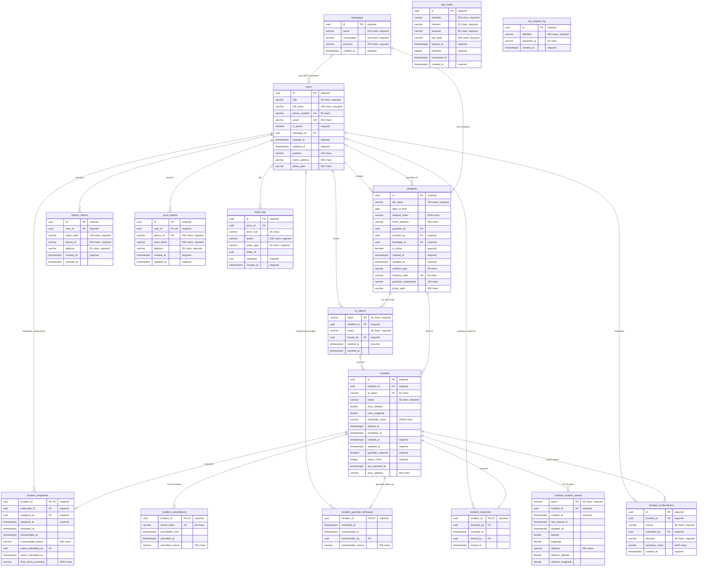

# ResQR entity-relationship diagram

The database as of migration `016_profile_photos.sql`: 16 tables and one
view, in four groups.

| Group | Tables |
|---|---|
| People | `barangays`, `users`, `residents` |
| Alerts | `qr_tokens`, `incidents`, `incident_responses`, `incident_guardian_followups`, `incident_outcomes`, `incident_cancellations`, `incident_confirmations`, `incident_location_shares` |
| Login | `otp_codes`, `otp_request_log`, `refresh_tokens`, `push_tokens` |
| Records | `audit_logs` |

The view `incident_details` joins `incidents` with its five topic tables
(responses, guardian follow-ups, outcomes, cancellations, latest live
location) into one row per alert, using the original column names.
`schema_migrations` (which migrations have run) is not shown.

Notation: `||` exactly one, `o|` zero or one, `o{` zero or more.
PK = primary key, FK = links to another table, UK = must be unique.

