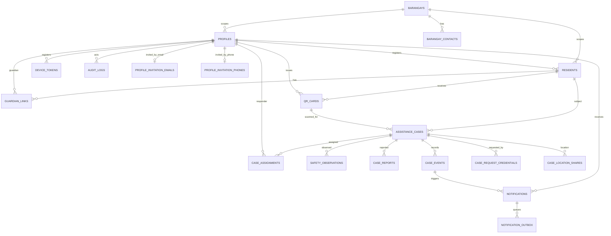

# Project B database ERD

The application schema is private `qralalay`. `public` contains the small RPC boundary exposed through Supabase PostgREST. The diagram shows major relationships; audit and worker tables are included even where they do not participate in a user-facing flow.

## Data groups

- **Identity and scope:** `barangays`, `profiles`, `profile_invitation_emails`, `profile_invitation_phones`.
- **Resident and QR:** `residents`, `guardian_links`, `qr_cards`, `barangay_contacts`.
- **Assistance workflow:** `assistance_cases`, `case_assignments`, `safety_observations`, `case_reports`, `case_events`.
- **Notifications:** `device_tokens`, `notifications`, `notification_outbox`.
- **Public request controls:** `case_request_credentials`, `case_location_shares`, `public_request_buckets`.
- **Audit:** `audit_logs`.

The encrypted QR token column is nullable. Existing cards have no recoverable token and remain scan-valid through their stored hash; newly issued cards can be re-exported only while the versioned Edge secret is retained.
